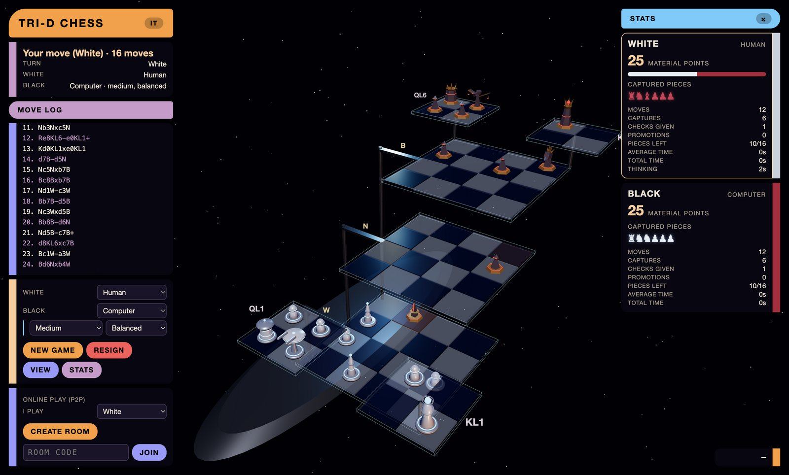

# Tri-D Chess

**Three-dimensional chess on seven levels** — movable attack boards, Jens Meder's tournament rules, a computer opponent, serverless peer-to-peer online play with chat, and AI players via MCP.

🇮🇹 [Versione italiana più sotto](#italiano)

**▶ Play in your browser:** https://nicolorisitano82.github.io/tri-d-chess/play/
**Website:** https://nicolorisitano82.github.io/tri-d-chess/



## Features

- **3D board**: three fixed 4×4 boards (W, N, B) and four 2×2 attack boards on twelve pins, rendered with Three.js.
- **Official rules** ([Meder](https://meder.spacechess.org/3dschach/chess3d.htm)): movable attack boards (forward, sideways, backwards when empty), castling, en passant across levels, per-file promotion with a choice of piece, draws by stalemate, threefold repetition, insufficient material and the 50-move rule.
- **Classic chess too**: switch the Game menu to classic chess (FIDE rules via [chess.js](https://github.com/jhlywa/chess.js)) on a walnut-and-maple board in a torch-lit medieval room, with ivory and ebony pieces. Computer, online play, lobby, clock, replay and MCP all work for both games.
- **Computer opponent**: 5 levels (Beginner → Master) × 3 styles (balanced, aggressive, cautious), set separately for White and Black.
- **Online play, no game server**: share a room code; [Trystero](https://github.com/dmotz/trystero) finds the other player through public Nostr relays, then the game flows directly between the two browsers over encrypted WebRTC. Reconnect with the same code. Online games are human vs human only.
- **Serverless lobby**: public rooms are announced as signed, expiring Nostr events (NIP-78 / NIP-40) with a throwaway key, so anyone can see who is waiting and join with one tap; uncheck the box for a private, code-only room.
- **Spettatori**: con il pulsante Guarda, o con un link `?watch=CODICE`, si segue una partita in rete senza giocare. Le partite pubbliche in corso compaiono nella lobby come «In corso · guarda».
- **Nickname**: facoltativo, dal menu principale. Compare nel pannello, sull'orologio, nella chat e nella lobby; in rete i due giocatori (e gli spettatori) vedono i nomi di entrambi.
- **Chat**: short messages (≤512 chars) with emoji and animated reactions, rate-limited per minute on both ends.
- **Online extras**: invite links for X, Threads, Facebook, WhatsApp and Telegram (`?room=CODE` joins directly), optional chess clock (5/10/15 min, with or without increment), one-tap rematch with colours swapped.
- **Replay**: step through any finished game move by move and share it as a link (`?replay=…`).
- **Installable web app (PWA)**: add the browser demo to your phone's home screen; it also works offline against the computer.
- **AI via MCP**: a built-in MCP server lets Claude or any MCP client play one colour, or two AIs play each other.
- **Italian and English**, statistics panel, victory animation, original piece designs.

## Play

| Where | What you get |
|---|---|
| [Browser demo](https://nicolorisitano82.github.io/tri-d-chess/play/) | computer, online games with chat (no MCP) |
| macOS app ([Releases](https://github.com/nicolorisitano82/tri-d-chess/releases)) | everything, including the MCP server |
| From source | everything |

The macOS app is ad-hoc signed (no Developer ID): the first time, right-click the app → Open.

### From source

Requires Node.js ≥ 18.

```bash
git clone https://github.com/nicolorisitano82/tri-d-chess.git
cd tri-d-chess
npm install
npm start          # game server + UI on http://localhost:47321
npm run app        # Electron app
npm run dist       # macOS DMG in dist/
npm test           # rules engine tests
```

### Connect an AI (MCP)

With the app or `npm start` running, each AI connects with its own colour:

```bash
claude mcp add --transport http tri-d-chess-white "http://localhost:47321/mcp?color=white"
claude mcp add --transport http tri-d-chess-black "http://localhost:47321/mcp?color=black"
```

Then, in a new Claude Code session: *"Read get_rules and play Black: alternate wait_for_my_turn and make_move until the game ends."*

MCP tools: `get_rules`, `get_game_state`, `get_legal_moves`, `make_move` (squares like `b2W`, pins like `QL1` for attack-board moves, `0-0` / `0-0-0` to castle, `promotion`), `wait_for_my_turn`, `new_game`, `resign`.

## Rules at a glance

- Square = file + rank + level: `a2W`, `c5N`, `d0KL1` (attack-board squares are named after the pin they sit on).
- A move is legal if it is legal on the flat projection; the piece may land on any level that has that square. A piece blocks movement on every level; knights jump; no purely vertical moves.
- Moving an attack board is a move: to a linked empty pin (1-2, 1-3, 2-3, 2-4, 3-4, 3-5, 4-5, 4-6, 5-6) or sideways (QLn ↔ KLn). Allowed when empty (by its owner) or with one piece (by that piece's owner); an occupied board moves only forward or sideways.
- Castling is not allowed as a player's first move. Promotion: files b–c on rank 8/1, z–e on 9/0, a–d on 9/0 when an attack board overhangs the corner, otherwise 8/1.
- The starting position matches the diagram in Meder's tournament rules (checked by a test).

## Project layout

| Path | |
|---|---|
| `src/engine.js` | rules engine (also used in the browser) |
| `src/ai.js` | computer player (alpha-beta with transposition table, levels and styles) |
| `src/chess2d.js`, `src/ai-chess.js`, `src/games.js` | classic chess on chess.js, its computer player, the game-kind registry |
| `server.js` | Express: UI, REST + SSE, network endpoints, MCP server |
| `electron/main.js` | macOS app |
| `public/` | Three.js client: `app.js`, `pieces.js`, `chess-view.js` (medieval board), `i18n.js`, `net.js` (P2P), `chat.js`, `lobby.js` |
| `scripts/build-web.mjs` | standalone pages: `npm run pages` → `docs/play/`, `npm run web` → `dist-web/` |
| `scripts/build-site.mjs`, `website/` | static English website + game at `/play/`: `npm run site:altervista` → `site/` |
| `scripts/deploy-site.mjs` | `npm run deploy`: uploads only changed files of `site/` by FTP (lftp) as `*.__new`, verifies each over HTTPS, then renames them live — no half-written files for visitors (`--dry-run`, `--all`) |
| `docs/` | GitHub Pages site and playable demo |
| `test/` | engine and rules tests |

Not affiliated with any science-fiction franchise. Piece designs are original.

---

<a id="italiano"></a>

# Tri-D Chess (italiano)

**Scacchi tridimensionali su sette livelli**: tavole d'attacco mobili, regole da torneo di Jens Meder, computer avversario, gioco in rete P2P senza server con chat, e AI via MCP.

**▶ Gioca nel browser:** https://nicolorisitano82.github.io/tri-d-chess/play/
**Sito:** https://nicolorisitano82.github.io/tri-d-chess/

## Caratteristiche

- **Scacchiera 3D**: tre tavole fisse 4×4 (W, N, B) e quattro tavole d'attacco 2×2 su dodici agganci.
- **Regole ufficiali** di Meder: tavole d'attacco mobili (avanti, di lato, indietro se vuote), arrocco, en passant anche tra livelli, promozione per colonna a scelta del pezzo, patte per stallo, triplice ripetizione, materiale insufficiente e 50 mosse.
- **Anche scacchi classici**: dal menu Gioco passi agli scacchi classici (regole FIDE tramite [chess.js](https://github.com/jhlywa/chess.js)) su una scacchiera in noce e acero, in una sala medievale illuminata da torce, con pezzi in avorio ed ebano. Computer, rete, lobby, orologio, replay e MCP valgono per entrambi i giochi.
- **Anche la dama, in cinque varianti**: italiana, internazionale (10×10), inglese (checkers), russa e brasiliana, nella stessa sala medievale. Presa obbligatoria con le regole di scelta di ciascuna variante, dama volante dove previsto, computer a 5 livelli, gioco in rete, replay, annulla e suggerimento.
- **Quattro set di pezzi per il Tri-D**: Federazione, Klingon, Borg e Romulani, scelti separatamente per Bianco e Nero dal menu Pezzi (design originali ispirati alle fazioni, senza simboli ufficiali). La scelta è solo estetica e resta sul tuo dispositivo.
- **Regole consultabili**: il pulsante Regole apre una pagina con ricerca, in italiano e inglese, con le regole del Tri-D (Meder) e degli scacchi classici (FIDE). Si apre anche con `?rules` nell'indirizzo.
- **Tutorial interattivo**: sette lezioni brevi sulla scacchiera vera (livelli, proiezione, cavallo, tavole d'attacco, promozione, matto), aperte dalla pagina Regole o con `?tutorial`.
- **Accessibilità**: mosse da tastiera (`b2W b4N`, `QL1 QL3`, `e2e4`, `0-0`; tasto M), mosse e stato annunciati ai lettori di schermo, descrizione testuale della posizione, tema ad alto contrasto, animazioni ridotte se il sistema lo chiede.
- **Pannello compatto** (desktop): bottone ◂ o tasto P, restano solo turno e mosse in trasparenza.
- **Notifiche** nelle partite in rete: con la scheda in background avvisa di mosse, chat, ingresso dell'avversario, rivincita e fine partita (notifica di sistema e contatore nel titolo).
- **Computer**: 5 livelli (Principiante → Maestro) × 3 stili (equilibrato, aggressivo, prudente), separati per Bianco e Nero.
- **Annulla e suggerimento** (solo partite in locale, contro il computer o in due sullo stesso schermo): Annulla toglie la tua ultima mossa e la risposta del computer; Suggerisci chiede al computer (livello 4) la mossa migliore e la segna con un anello dorato.
- **In rete senza server**: condividi un codice stanza; Trystero trova l'avversario tramite relay Nostr pubblici, poi la partita viaggia direttamente tra i due browser via WebRTC cifrato. Ci si può ricollegare con lo stesso codice. Le partite in rete sono solo umano contro umano.
- **Lobby senza server**: le stanze pubbliche vengono annunciate come eventi Nostr firmati e con scadenza, con una chiave usa-e-getta: chiunque vede chi è in attesa ed entra con un tocco. Togliendo la spunta la stanza resta privata, solo col codice.
- **Chat**: messaggi brevi (≤512 caratteri) con emoticon e reaction animate, con limiti al minuto da entrambe le parti.
- **Extra in rete**: link di invito per X, Threads, Facebook, WhatsApp e Telegram (`?room=CODICE` entra direttamente), orologio facoltativo (5/10/15 minuti, con o senza incremento), rivincita con un tocco e colori invertiti.
- **Replay**: rivedi mossa per mossa qualunque partita finita e condividila come link (`?replay=…`).
- **Web app installabile (PWA)**: aggiungi la demo alla schermata Home del telefono; funziona anche offline contro il computer.
- **AI via MCP**: un server MCP integrato permette a Claude o a un altro client MCP di giocare un colore, o a due AI di sfidarsi.
- **Italiano e inglese**, statistiche, animazione di vittoria, pezzi dal design originale.

## Come giocare

- **Browser**: la [demo](https://nicolorisitano82.github.io/tri-d-chess/play/) — computer e partite in rete con chat (niente MCP).
- **App per macOS**: DMG nelle [Release](https://github.com/nicolorisitano82/tri-d-chess/releases); firma ad-hoc, al primo avvio clic destro → Apri.
- **Dal sorgente**: `npm install`, poi `npm start` (http://localhost:47321), `npm run app` (Electron) o `npm run dist` (DMG).

### Collegare un'AI (MCP)

Con l'app o il server avviati, un endpoint per colore:

```bash
claude mcp add --transport http tri-d-chess-white "http://localhost:47321/mcp?color=white"
claude mcp add --transport http tri-d-chess-black "http://localhost:47321/mcp?color=black"
```

Poi in una nuova sessione di Claude Code: *"Leggi get_rules e gioca col Nero: alterna wait_for_my_turn e make_move finché la partita non finisce."*

## Regole in breve

- Casella = colonna + traversa + livello (`a2W`, `d0KL1`); le caselle di una tavola d'attacco prendono il nome dell'aggancio.
- Una mossa è valida se lo è vista dall'alto; il pezzo atterra su un livello qualunque che abbia quella casella. Un pezzo blocca il passaggio su tutti i livelli; il cavallo salta.
- Spostare una tavola d'attacco è una mossa: verso un aggancio libero collegato o di lato (QLn ↔ KLn); vuota (la sposta il proprietario) o con un solo pezzo (lo sposta chi possiede il pezzo); occupata solo avanti o di lato.
- Arrocco non come prima mossa del giocatore. Promozione: colonne b–c su 8/1, z–e su 9/0, a–d su 9/0 se una tavola d'attacco sovrasta l'angolo, altrimenti 8/1.
- La posizione iniziale corrisponde al diagramma delle regole da torneo di Meder (verificata da un test).

Progetto amatoriale, non affiliato ad alcun marchio di fantascienza. Pezzi dal design originale.

## Licenza / License

Tri-D Chess è software libero: puoi ridistribuirlo e/o modificarlo secondo i termini della GNU General Public License, versione 3 o (a tua scelta) successiva. Il testo completo è nel file [LICENSE](LICENSE).

Tri-D Chess is free software: you can redistribute it and/or modify it under the terms of the GNU General Public License, version 3 or (at your option) any later version. See [LICENSE](LICENSE).

Le librerie incluse mantengono le proprie licenze (three.js, chess.js, Trystero, ecc.). / Bundled libraries keep their own licenses (three.js, chess.js, Trystero, etc.).
